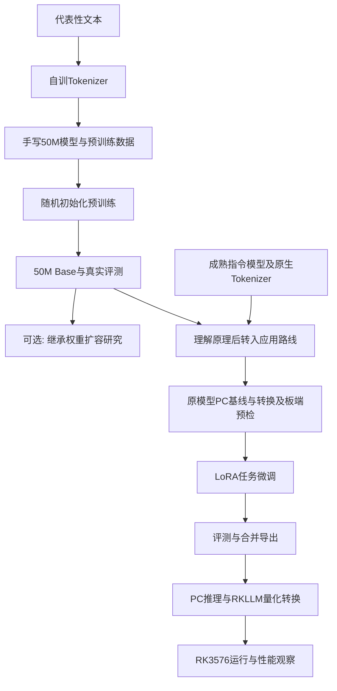

# 0.2 LLM 从训练到部署的完整生命周期

先沿50M路线追踪“Linux 是一个操作系统”：Tokenizer把文字切成ID，模型根据前面的ID预测后续ID；预测与真实文本不同，就通过梯度更新参数。预训练得到Base，它表示权重经历了预训练阶段，不表示已经可靠理解知识或可以聊天。

| 阶段 | 本课程输入 | 输出与判断 |
|---|---|---|
| Tokenizer与模型实现 | 教学语料、结构规格 | 自训词表和可计算的50M模型 |
| 预训练与评价 | 随机权重、冻结数据划分 | 50M Base、训练记录、原始生成结果 |
| 原模型预检 | 成熟模型及其配套文件 | PC基线、转换记录、板端最小运行记录 |
| LoRA任务适配 | 同一成熟模型、独立划分的任务样本 | 适配器与微调前后评测 |
| 合并与推理 | 基座原权重、匹配的适配器 | 可重载的标准模型目录与生成记录 |
| 量化与部署 | 合并目录、校准文本、RKLLM工具链 | 量化模型、C/C++应用及板端实测 |

50M的32K词表和模型实现只适用于该教学权重。成熟模型必须保留其原生Tokenizer、配置和聊天模板；共同的学习目标不意味着文件可以互换。微调、推理和板端应使用同一候选模型版本及同一模板。

第3.4节保留自训架构导出的可选实验。成熟模型的转换和板端预检由第7.1节引用第9.1、10.1节提前执行，不要求学习者先完成LoRA训练才发现部署不兼容。正式合并权重仍要重新验证，原模型通过不能替代微调后模型的检查。
