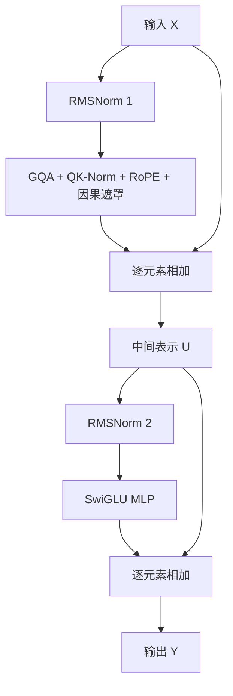

# 2.3 RMSNorm、SwiGLU 与 Residual

上一节的 Attention 已经让每个位置读取了允许访问的上下文。要把它接成一个可重复堆叠的 Transformer Block，还需要调整输入尺度、加工各位置的特征，并保留原来的表示。本节把这几步接起来，最后得到一个输入、输出均为 `[B,T,H]` 的 Block。B 是序列条数，T 是每条序列的 Token 数，H 是每个位置的特征数；沿用微型例子时，这个形状就是 `[1,5,4]`。

先看怎样调整一个位置的数值尺度。上一节的 QK-Norm 用过 `[3,4]`：平方后是 `[9,16]`，平均值为 12.5，再开根号得到约 3.5355。用这个均方根除原向量，结果约为 `[0.8485,1.1314]`。RMSNorm（均方根归一化）还会乘上一组可训练的逐维缩放参数 γ；γ 为 `[1,1]` 时保持上述结果，改成 `[2,1]`，第一维变为约 1.6971，第二维保持约 1.1314。

下面的标准库代码可以在 Python 中直接执行。它只处理一条向量，便于观察每一步：

```python
import math

def rms_norm(x, gamma, eps=1e-6):
    # 在当前向量内部求均方根；eps 避免全零输入除以零。
    scale = math.sqrt(sum(value * value for value in x) / len(x) + eps)
    return [value / scale * gain for value, gain in zip(x, gamma)]

print([round(v, 4) for v in rms_norm([3.0, 4.0], [1.0, 1.0])])
# [0.8485, 1.1314]
print(rms_norm([0.0, 0.0], [1.0, 1.0]))
# [0.0, 0.0]
```

`eps` 是很小的正数，所以全零输入也有非零分母。对于 Block 中一个长度 H 的向量 x，这个计算概括为：

$$
\operatorname{RMSNorm}(x)_i
=\frac{x_i}{\sqrt{\frac1H\sum_{j=1}^{H}x_j^2+\epsilon}}\gamma_i.
$$

i 是当前特征的下标，j 遍历该位置的全部 H 个特征；γ 的长度也是 H。处理 `[B,T,H]` 时，每条序列、每个位置都独立计算最后一维，不把不同 Token 或不同样本混在一起求平均。它保留向量形状，控制尺度后仍允许模型通过 γ 调整各维作用。

这里与 QK-Norm 的区别在于处理对象：Block 的 RMSNorm 处理 H 维隐藏向量，QK-Norm 处理每个头内的 d 维 Q 或 K，参数也不共享。RMSNorm 不先减输入均值，因此输出均值不要求为零；LayerNorm 通常先减均值再按方差缩放。本课程实现 RMSNorm，后续读代码时认清它的计算位置即可。

调整尺度后，还要加工每个位置的特征。Attention 负责位置之间的信息汇总，前馈网络（FFN，也称 MLP）则对每个位置分别使用同一套矩阵。这一步本身不让不同 Token 交换信息，但可以重新组合已经带有上下文的特征。

LubanLM 使用带门控的 SwiGLU。先从同一输入分别生成 gate 和 up 两条支路；gate 经过非线性函数，再与 up 对应分量相乘；最后用 down 投影回原宽度。以下是独立手算例子，取 `H=2,I=3,x=[1,2]`，其中 I 是前馈网络的中间宽度：

$$
W_{\mathrm{gate}}=\begin{bmatrix}1&0&-1\\0&0&0\end{bmatrix},\quad
W_{\mathrm{up}}=\begin{bmatrix}2&0&1\\0&\frac32&\frac32\end{bmatrix},\quad
W_{\mathrm{down}}=\begin{bmatrix}1&0\\0&1\\1&1\end{bmatrix}.
$$

输入与 gate 矩阵的每列做点积，得到 `[1,0,-1]`；与 up 矩阵各列做点积，得到 `[2,3,4]`。虽然输入相同，两套矩阵可以产生不同结果。接着对 gate 的每个数使用 SiLU：

$$
\operatorname{SiLU}(a)=a\,\sigma(a)=\frac{a}{1+e^{-a}}.
$$

a 是一个输入数，`σ(a)` 是 sigmoid 函数。gate 经过它约为 `[0.7311,0,-0.2689]`，再与 up 的 `[2,3,4]` 对应相乘，得到约 `[1.4621,0,-1.0758]`。down 矩阵的第一列把第一个和第三个分量相加，第二列把第二个和第三个分量相加，最终回到两个特征，约为 `[0.3864,-1.0758]`。

可以用下面的完整片段复核。`project` 与上一节投影的解释一致：每一列算一个输出分量。

```python
import math

def project(x, weights):
    return [sum(x[i] * weights[i][j] for i in range(len(x)))
            for j in range(len(weights[0]))]

x = [1.0, 2.0]
gate = project(x, [[1, 0, -1], [0, 0, 0]])
up = project(x, [[2, 0, 1], [0, 1.5, 1.5]])
activated = [value / (1 + math.exp(-value)) for value in gate]
z = [a * b for a, b in zip(activated, up)]
output = project(z, [[1, 0], [0, 1], [1, 1]])
print([round(v, 4) for v in output])  # [0.3864, -1.0758]
```

将这几步写成公式，就是：

$$
g=xW_{\mathrm{gate}},\quad u=xW_{\mathrm{up}},\quad
z=\operatorname{SiLU}(g)\odot u,\quad
\operatorname{MLP}(x)=zW_{\mathrm{down}}.
$$

g 和 u 是两条投影结果，z 是门控后的中间向量；`⊙` 表示逐元素相乘。gate、up 的矩阵都是 `[H,I]`，down 为 `[I,H]`。放回微型 Block，输入 `[1,5,4]` 先在两条支路变成 `[1,5,6]`，相乘后形状不变，再投回 `[1,5,4]`。

SiLU 让计算具有非线性。若始终只有矩阵乘法，连续多层仍可合并成一次线性变换；加入非线性后不再如此。这里的“门”是可学习的特征调节，SiLU 可以为负，也可以超过 1，不能把它当成严格的 0～1 概率开关。将上面代码的 up 结果全部置零，z 和最终输出都会归零；保持 up、把 gate 置零，也会归零。这能直接看到两条支路怎样共同决定输出。增大 I 会增加中间特征数、三个矩阵的参数和计算量，但不改变外部宽度 H。

现在有了 Attention 和 MLP 两个分支，还要保留输入继续向后传递的路径。残差连接（Residual）将分支输出加回原输入：若 `x=[1,2]`，分支得到 `F(x)=[0.1,-0.3]`，相加就是 `[1.1,1.7]`。两边必须形状相同，这也是 Attention 输出投影与 MLP down 都要回到 H 维的原因。

这种连接让分支在已有表示上学习修正量；即使分支输出为零，原输入仍能继续传递。加法在反向传播时也保留一条直接路径，有助于深层网络传递信息和梯度，但不能保证所有训练设置都稳定。残差加法本身不增加权重参数。

LubanLM 在进入各分支前先做归一化，称为 Pre-Norm；旁路保留的是归一化之前的输入。一次 Block 的计算为：

$$
U=X+\operatorname{Attention}(\operatorname{RMSNorm}_1(X)),
$$
$$
Y=U+\operatorname{MLP}(\operatorname{RMSNorm}_2(U)).
$$

先将 Attention 的结果加回 X，得到 U；第二次归一化和 MLP 都接收 U，第二条残差也加回 U，而不是最初的 X。两次 RMSNorm 各有独立的 H 维参数，所有分支输出都回到 `[B,T,H]`。按图追踪旁路，可以核对两次加法：



对应的结构伪代码只有两行：

```python
u = x + attention(norm1(x))
y = u + mlp(norm2(u))
```

这两行用来核对执行顺序，不能直接当成独立程序运行。实现时 x、u 都是张量，`+` 表示逐元素相加；Python 列表的 `+` 会拼接列表，含义不同。

堆叠 L 个这样的 Block 后，模型还会做一次 Final RMSNorm，再进入 LM Head。因此每层既要统计两个 H 维 Block Norm，也要统计 Attention 中两个 d 维 Q/K Norm，末尾还有一个 H 维 Norm。[下一节](C2S4.md)将按这些模块计算模型规格与参数总量。
